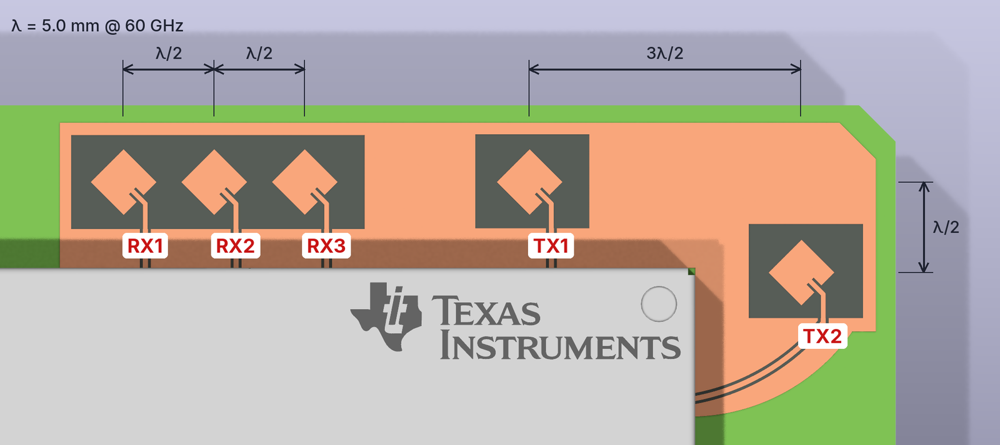

# IWRL6432WMOD — KiCad symbol & footprint


<sub>Rendered in KiCad 10 with this footprint. Module body, shield and pads: official STEP model by **Texas Instruments** — <a href="https://www.ti.com/lit/zip/SWRM078">SWRM078</a> (<code>IWRL6432WMOD_3D.step</code>), © Texas Instruments, not included in this repository. Etched antenna array, exposed copper and test pad: <code>3d/IWRL6432WMOD_antennas.step</code> from this repository.</sub>

KiCad library for the Texas Instruments **IWRL6432WMOD**. It is a 60 GHz mmWave radar module for motion and presence detection, in a 30-pin QFM / LGA package (MBB0030A).

The library contains a schematic symbol, a footprint made from the TI land pattern, and a 3D overlay with the antenna array etched on the module PCB. The TI model leaves the antennas out.

> **3D model:** the official TI STEP model is **not included**. Download it from Texas Instruments:
> **→ <https://www.ti.com/lit/zip/SWRM078>** (`SWRM078.zip` → `IWRL6432WMOD_3D.step`)
>
> The footprint is already aligned to this exact file (offset and rotation preset). See *Installation* below.
> The antenna overlay (`3d/IWRL6432WMOD_antennas.step`) is included and loads on top of the TI model automatically.

## Contents

| Path | What |
|------|------|
| `symbols/IWRL6432WMOD.kicad_sym` | Schematic symbol `IWRL6432WMOD` |
| `footprints/IWRL6432WMOD.pretty/` | Footprint `MOD_IWRL6432WMOD_LGA30` |
| `3d/IWRL6432WMOD_antennas.step` | 3D overlay: etched 60 GHz patch antennas, feed lines, exposed copper, test pad |
| `3d/src/mkstep_iwrl6432wmod_antennas.py` | Script that generates the overlay (OCP + shapely) |
| `images/` | Pictures used in this README |

## Symbol


All 30 pins follow the datasheet (SWRS350, Table 5-1):

| Function | Pins |
|----------|------|
| VCC (3.3 V) | 7, 8 |
| VIOIN (3.3 V I/O supply) | 29 |
| GND | 5, 6, 25, 27, 28, 30 |
| SPI_BUSY / SPI_MOSI / SPI_MISO / SPI_CLK / SPI_CS | 1 / 21 / 18 / 20 / 19 |
| UART_TX / UART_RX (uDFP patch updates only) | 13 / 12 |
| SOP0 | 10 |
| NRESET | 15 |
| Presence indication output | 2 |
| Module wake-up input | 3 |
| NC / reserved | 4, 9, 11, 14, 16, 17, 22, 23, 24, 26 |

> All digital I/O except NRESET are **not fail-safe**. Do not drive them while VIOIN is unpowered.

## Footprint


- The land pattern follows the TI *Example Board Layout* for MBB0030A:
  - 30 square pads, 0.7 mm,
  - pitch 3.4 mm along the long side and 3.8 mm between rows,
  - 9 × 4 grid with the six centre positions empty.
- The footprint is rotated 90° against the TI drawing. The pin numbering matches it exactly.
- Pin 1 is at the chamfered corner of the silkscreen outline.
- The F.Fab layer marks the antenna field of view: no metal or tall parts above the antennas.
- The footprint loads two 3D models with the same offset and rotation: the TI model and the antenna overlay. Both sit on the pads without any adjustment.

## 3D model

### Module body (from TI)

- The STEP model is published by Texas Instruments as [SWRM078](https://www.ti.com/lit/zip/SWRM078). It is not redistributed here.
- Size 15.5 × 31.0 × 3.76 mm; the datasheet gives a maximum height of 3.8 mm.
- The TI model shows the module PCB as a plain light-green board: the antenna area is not modelled.

### Antenna overlay (this repository)



`3d/IWRL6432WMOD_antennas.step` adds the top-layer RF structures that you can see on a real module. They follow the module photo and the array geometry in SWRS350 §6.7 (Fig. 6-4):

- **Elements:** 5 single-element microstrip patch antennas, 3 receive (RX1–RX3) and 2 transmit (TX1, TX2). Each patch is square, about 1.28 mm per side, and rotated 45°. The fed edge points away from the shield.
- **Feed:** each patch has an inset feed (inset depth about 0.30 mm, line 0.13 mm, slot 0.07 mm on each side of the line). Outside the patch windows the feed continues as a grounded coplanar waveguide (GCPW): a 0.14 mm centre strip with 0.08 mm gaps in the ground copper. The lines run under the shield to the IWRL6432W RF ports. TX2 is fed by a curved GCPW around the end of the shield.
- **Copper and laminate:** the antenna area is exposed top-layer ground copper with no solder mask (0.035 mm). Under each patch group the copper is etched away down to the RF laminate: one window for RX1–RX3, one for TX1, one for TX2. The patches stand 0.035 mm above the laminate, so in the 3D view they look etched, as on the real board.
- **Array geometry** (λ = 5.0 mm at 60 GHz):
  - RX1–RX3: one row along the 31 mm side, pitch λ/2 = 2.5 mm (azimuth),
  - TX1 → TX2: 3λ/2 = 7.5 mm in azimuth and λ/2 = 2.5 mm in elevation.
  - The 2 TX × 3 RX MIMO combinations give a virtual array of 2 rows × 6 elements (azimuth: 6 × λ/2, elevation: 2 rows λ/2 apart). This gives the 19° azimuth angular resolution in the datasheet and lets the module measure elevation as well as azimuth (3D detection).
- **Also modelled:** the round test pad (Ø 3.1 mm copper ring, Ø 1.05 mm exposed pad) in the corner next to TX2.
- **Solder mask:** the rest of the module top (around the antenna area, the round pad and the shield can) and the four
  PCB edges get a dark green solder-mask skin (0.01 mm). It covers the light green of the TI model, so the module looks
  like a normal dark-green PCB next to the host board. The colour is set by `C_MASK` in the script.
- **Coordinates:** the overlay uses the TI model's coordinate system (module top at z = 1.6 mm), so it shares the offset and rotation of the TI model in the footprint. Height above the module PCB is 0.035 mm, so the module height (3.76 mm) does not change.

Accuracy and intended use:
- The overlay is meant for **visual and mechanical** use: 3D viewer, renders, collision and keep-out checks. The element spacing follows the λ/2 grid in the datasheet. Patch size, windows and feed lines were measured from the TI module photo (about 31 px/mm), so expect about ±0.1 mm.
- It is **not** an RF model. The substrate, stack-up and exact patch dimensions are not published, so do not use it for EM simulation or antenna design.
- Datasheet antenna figures: gain 4.4 dBi, FoV ±60° in azimuth and in elevation, 57–61.5 GHz.
- Layout rule: keep metal, tall parts and enclosure ribs out of the area above the antennas (marked on F.Fab). Any plastic radome over the antennas must be designed for 60 GHz: about λ/(2√εr) thick, or as thin as possible.

To regenerate the overlay (needs `pip install cadquery-ocp shapely`):

```sh
python3 3d/src/mkstep_iwrl6432wmod_antennas.py 3d/IWRL6432WMOD_antennas.step
```

## Installation

1. Download [SWRM078.zip](https://www.ti.com/lit/zip/SWRM078) and extract `IWRL6432WMOD_3D.step` into the `3d/` folder of this repository, next to `IWRL6432WMOD_antennas.step`.
   *Preferences → Configure Paths*: add `IWRL6432WMOD_DIR` pointing to this repository. The footprint loads `${IWRL6432WMOD_DIR}/3d/IWRL6432WMOD_3D.step` and `${IWRL6432WMOD_DIR}/3d/IWRL6432WMOD_antennas.step`. Without the TI file, KiCad shows only the antenna overlay.
2. *Preferences → Manage Symbol Libraries*: add `symbols/IWRL6432WMOD.kicad_sym` with the nickname `IWRL6432WMOD`.
3. *Preferences → Manage Footprint Libraries*: add `footprints/IWRL6432WMOD.pretty` with the nickname `IWRL6432WMOD`.

The symbol already points to `IWRL6432WMOD:MOD_IWRL6432WMOD_LGA30`.

## License

The symbol, footprint and antenna overlay (with its generator script) are released under **CC-BY-SA 4.0 with the KiCad library exception** — the same terms as the official KiCad libraries.
You can use it in any PCB design (including closed-source and commercial ones) without the design falling under CC-BY-SA.
Modified versions of the files themselves must keep attribution and stay under CC-BY-SA 4.0. See [NOTICE.md](NOTICE.md) for the exception and [LICENSE](LICENSE) for the full text.

## Disclaimer

- The IWRL6432WMOD datasheet (SWRS350, December 2025) is still marked **Advance Information**. Check the footprint against the latest TI documentation before ordering boards.
- The 3D model and its TI logo belong to Texas Instruments and are **not** covered by this repository's license; download them from TI. *Texas Instruments* and the TI logo are trademarks of Texas Instruments Incorporated. This project is not affiliated with TI.
