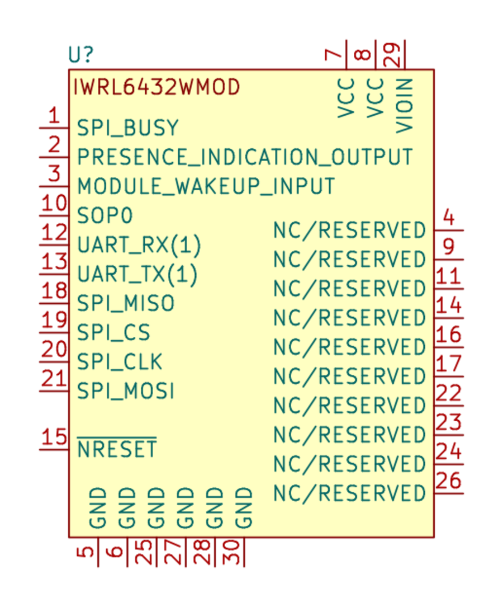
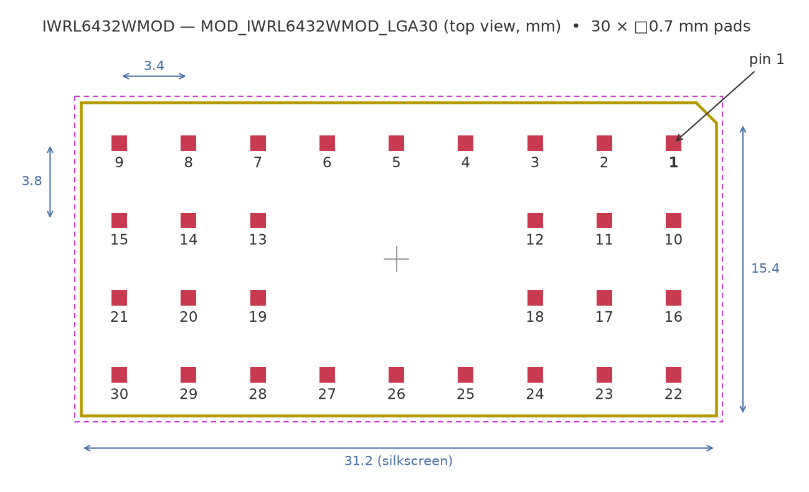

# IWRL6432WMOD — KiCad symbol & footprint

KiCad library for the Texas Instruments **IWRL6432WMOD**. It is a 60 GHz mmWave radar module for motion and presence detection, in a 30-pin QFM / LGA package (MBB0030A).

The library contains a schematic symbol and a footprint made from the TI land pattern.

> **3D model:** the official TI STEP model is **not included**. Download it from Texas Instruments:
> **→ <https://www.ti.com/lit/zip/SWRM078>** (`SWRM078.zip` → `IWRL6432WMOD_3D.step`)
>
> The footprint is already aligned to this exact file (offset and rotation preset). See *Installation* below.

## Contents

| Path | What |
|------|------|
| `symbols/IWRL6432WMOD.kicad_sym` | Schematic symbol `IWRL6432WMOD` |
| `footprints/IWRL6432WMOD.pretty/` | Footprint `MOD_IWRL6432WMOD_LGA30` |
| `images/` | Pictures used in this README (the 3D render shows the TI model) |

## Symbol

All 30 pins follow the datasheet (SWRS350, Table 5-1):

| Function | Pins |
|----------|------|
| VCC (3.3 V) | 7, 8 |
| VIOIN (3.3 V I/O supply) | 29 |
| GND | 5, 6, 25, 27, 28, 30 |
| SPI_BUSY / SPI_MOSI / SPI_MISO / SPI_CLK / SPI_CS | 1 / 21 / 18 / 20 / 19 |
| UART_TX / UART_RX (uDFP patch updates only) | 13 / 12 |
| SOP0 | 10 |
| NRESET | 15 |
| Presence indication output | 2 |
| Module wake-up input | 3 |
| NC / reserved | 4, 9, 11, 14, 16, 17, 22, 23, 24, 26 |

> All digital I/O except NRESET are **not fail-safe**. Do not drive them while VIOIN is unpowered.

## Footprint

- The land pattern follows the TI *Example Board Layout* for MBB0030A:
  - 30 square pads, 0.7 mm,
  - pitch 3.4 mm along the long side and 3.8 mm between rows,
  - 9 × 4 grid with the six centre positions empty.
- The footprint is rotated 90° against the TI drawing. The pin numbering matches it exactly.
- Pin 1 is at the chamfered corner of the silkscreen outline.
- The F.Fab layer marks the antenna field of view: no metal or tall parts above the antennas.
- The TI 3D model is referenced with the right offset and rotation, so it sits correctly on the pads without any adjustment.

## 3D model (from TI)

- The STEP model is published by Texas Instruments as [SWRM078](https://www.ti.com/lit/zip/SWRM078). It is not redistributed here.
- Size 15.5 × 31.0 × 3.76 mm; the datasheet gives a maximum height of 3.8 mm.

## Installation

1. Download [SWRM078.zip](https://www.ti.com/lit/zip/SWRM078) and extract `IWRL6432WMOD_3D.step` into a `3d/` folder inside this repository.
   *Preferences → Configure Paths*: add `IWRL6432WMOD_DIR` pointing to this repository. The footprint loads the model from `${IWRL6432WMOD_DIR}/3d/IWRL6432WMOD_3D.step`.
2. *Preferences → Manage Symbol Libraries*: add `symbols/IWRL6432WMOD.kicad_sym` with the nickname `IWRL6432WMOD`.
3. *Preferences → Manage Footprint Libraries*: add `footprints/IWRL6432WMOD.pretty` with the nickname `IWRL6432WMOD`.

The symbol already points to `IWRL6432WMOD:MOD_IWRL6432WMOD_LGA30`.

## License

The symbol and footprint are released under **CC-BY-SA 4.0 with the KiCad library exception** — the same terms as the official KiCad libraries.
You can use it in any PCB design (including closed-source and commercial ones) without the design falling under CC-BY-SA.
Modified versions of the files themselves must keep attribution and stay under CC-BY-SA 4.0. See [NOTICE.md](NOTICE.md) for the exception and [LICENSE](LICENSE) for the full text.

## Disclaimer

- The IWRL6432WMOD datasheet (SWRS350, December 2025) is still marked **Advance Information**. Check the footprint against the latest TI documentation before ordering boards.
- The 3D model and its TI logo belong to Texas Instruments and are **not** covered by this repository's license; download them from TI. *Texas Instruments* and the TI logo are trademarks of Texas Instruments Incorporated. This project is not affiliated with TI.
